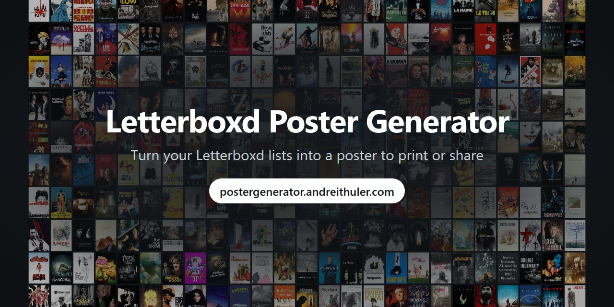
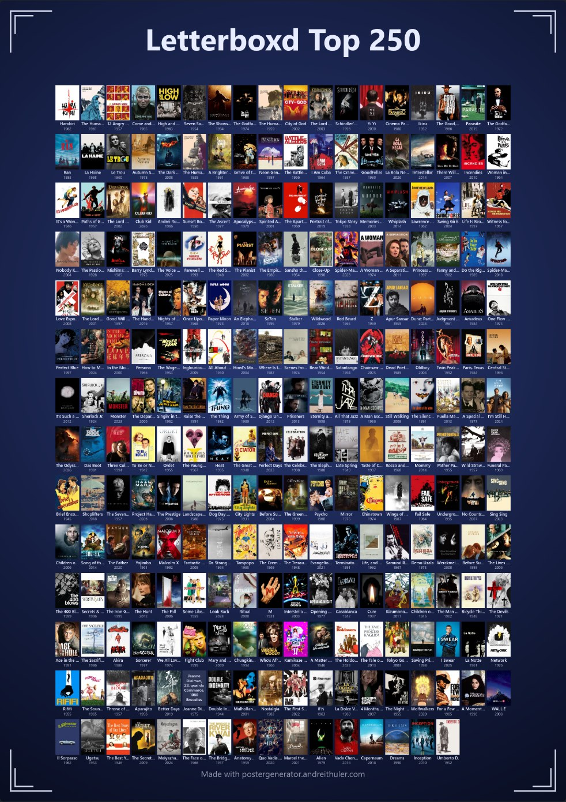
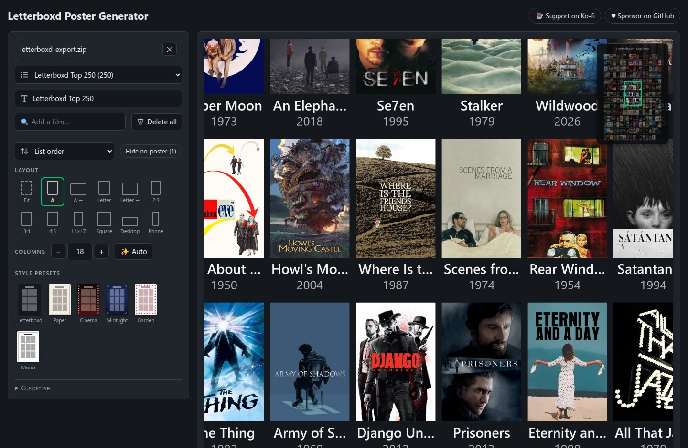

# Letterboxd Film Poster Generator

[](https://postergenerator.andreithuler.com)

<p align="center">
  <a href="https://ko-fi.com/andreithuler"></a>
  <a href="https://github.com/sponsors/athuler"></a>
</p>

[Turn your Letterboxd lists into a poster](https://postergenerator.andreithuler.com): a grid of film posters with a title and captions, ready to print, set as a wallpaper or share.

## Features

[](https://postergenerator.andreithuler.com)

- **Any list:** your Letterboxd lists, Watchlist, Watched or Ratings, or films you search for.
- **Edit on the poster:** drag to reorder, ✕ to remove, sort or shuffle.
- **Any size:** A and Letter paper, 11×17, square, wallpapers and more.
- **Styles:** six presets, or your own colours, fonts and borders.
- **Download** a PNG or a print-ready PDF (up to A0), or **share** it.
- **Remembered** for next time.

Four of the style presets:

<p>
  <a href="https://postergenerator.andreithuler.com"></a>
  <a href="https://postergenerator.andreithuler.com"></a>
</p>
<p>
  <a href="https://postergenerator.andreithuler.com"></a>
  <a href="https://postergenerator.andreithuler.com"></a>
</p>

Zoom in to check the details:

[](https://postergenerator.andreithuler.com)

## Get started

1. Download your Letterboxd data at <https://letterboxd.com/data/export/>.
2. Open the site and import the `.zip`.
3. Select one of your lists.
4. Choose a poster size and style. Open **Customise** to fine-tune it.
5. Click **Download…** to save it, or **Share…** to post it.

## Privacy

Your Letterboxd data never leaves your browser. Settings and posters are cached locally. The public site uses Google Analytics for visit counts.

## Support and feedback

Found a bug or have an idea? [Open an issue](https://github.com/athuler/LetterboxdPosterGenerator/issues).

If you enjoy it, you can support it on [Ko-fi](https://ko-fi.com/andreithuler) or [GitHub Sponsors](https://github.com/sponsors/athuler):

<p align="center">
  <a href="https://ko-fi.com/andreithuler"></a>
  <a href="https://github.com/sponsors/athuler"></a>
</p>

---

## Development

Plain HTML, CSS and JavaScript modules: no build step. The app is [index.html](index.html), [app.js](app.js) (everything interactive) and [parse.js](parse.js) (reads Letterboxd's CSV files).

### Run it locally

1. Get a free TMDB API key at <https://www.themoviedb.org/settings/api>.
2. Create `config.local.js` in the repo root (gitignored, never deployed):

   ```js
   export const TMDB_API_KEY = "your-tmdb-v3-key-or-v4-token";
   ```

3. Serve the folder and open <http://localhost:8765>:

   ```bash
   python3 -m http.server 8765
   ```

On `localhost`, a key in `config.local.js` makes the app call TMDB directly, skipping the Worker. Parser self-check: <http://localhost:8765/tests.html> should show `PASS`.

### Tests

Browser tests in [tests/](tests/) use [Playwright](https://playwright.dev). They cover importing an export, restoring after a reload, editing, search, poster sizes and styles, zoom, downloads (real PNG and PDF files), sharing and the CSV parser. TMDB and the poster images are faked, so no API key or network is needed.

Needs Node 18+ and Python 3 (for the static server the tests start on port 4173):

```bash
npm ci
npx playwright install chromium
npm test
```

GitHub Actions runs them on every pull request and branch push. On `main` they run before deploying, and a failure stops the deploy.

### How the TMDB key stays secret

The site never sees the TMDB key. It calls a small Cloudflare Worker ([worker/worker.js](worker/worker.js)) that holds the key as a secret, forwards `/search?query=…&year=…` to TMDB, and only answers requests from the allowed origins. [config.js](config.js) holds just the Worker's public URL. Poster images load straight from `image.tmdb.org`, which needs no key.

### Testing the Worker locally (optional)

Only needed when changing `worker/`. Remove `config.local.js` (or leave its key empty), then run the Worker and the site in two terminals:

1. Worker: create `worker/.dev.vars` (gitignored):

   ```
   TMDB_API_KEY=your-tmdb-v3-key
   ALLOWED_ORIGINS=http://localhost:8765
   ```

   then from `worker/`:

   ```bash
   npx wrangler dev --port 8787
   ```

2. Site, from the repo root:

   ```bash
   python3 -m http.server 8765
   ```

Without a local key, `config.js` points `localhost` at the local Worker on port 8787.

### Deploy

**Worker (once, then on every change under `worker/`):**

1. In Cloudflare, create an API token from the **Edit Cloudflare Workers** template and note your account ID.
2. Add repository secrets (**Settings → Secrets and variables → Actions**): `CLOUDFLARE_API_TOKEN`, `CLOUDFLARE_ACCOUNT_ID`, `TMDB_API_KEY`.
3. Run the **Deploy TMDB proxy Worker** workflow. It uploads `TMDB_API_KEY` as a Worker secret.
4. Put the Worker's `https://letterboxd-poster-tmdb.<subdomain>.workers.dev` URL into `config.js`.
5. Set `ALLOWED_ORIGINS` in [worker/wrangler.toml](worker/wrangler.toml) to the site's origin (currently `postergenerator.andreithuler.com`).

**Site:** set **Settings → Pages → Source: GitHub Actions**, then push to `main`.

**Analytics (optional):** add a repository variable (**Settings → Secrets and variables → Actions → Variables**) named `GA_MEASUREMENT_ID` with your Google Analytics ID (`G-…`). The deploy workflow then adds the Google tag to the published `index.html`; the repo copy and local runs stay untracked. Without the variable, nothing is added.

### Caching

- Per browser: poster lookups are cached in `localStorage` (including "no match") and deduplicated in memory, so each film is searched once; poster images are cached by the browser's HTTP cache.
- Shared: the Worker caches TMDB answers at Cloudflare's edge for a week. This only takes effect on a custom domain, not on `*.workers.dev`.

## Credits

Made by [Andrei Thüler](https://andreithuler.com). Posters and film data from the [TMDB](https://www.themoviedb.org/) API. Not affiliated with, endorsed by, or certified by TMDB or Letterboxd. Social icons from [Simple Icons](https://simpleicons.org) (CC0). Screenshots show the top 250 of [Letterboxd's Top 500 Films](https://letterboxd.com/official/list/letterboxds-top-500-films/).
